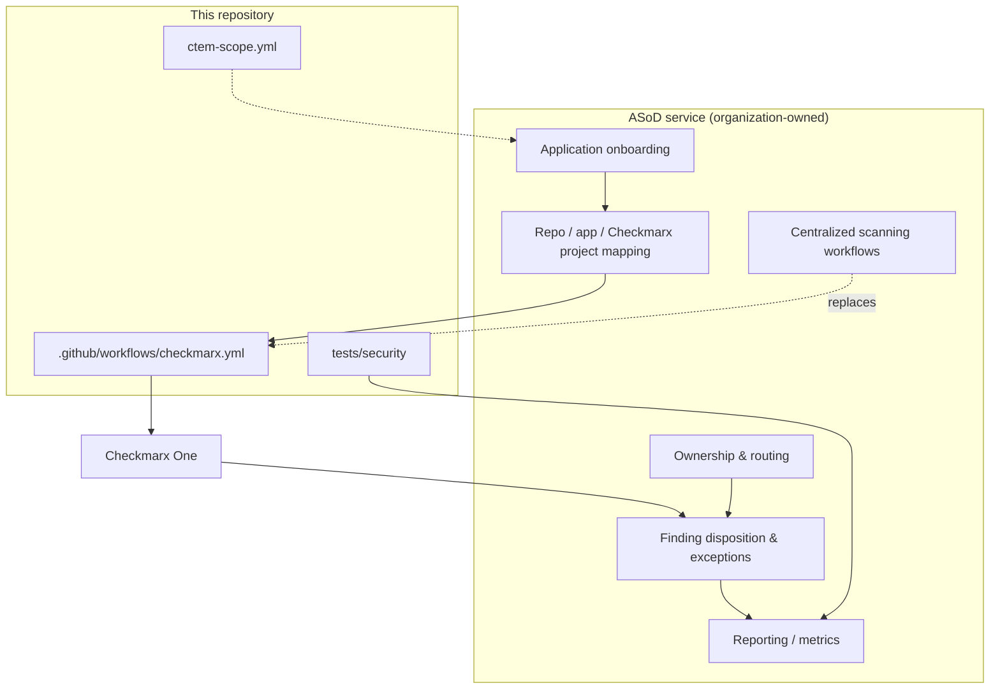

# ASoD Integration Points

This POC assumes the organization runs an **Application Security On Demand (ASoD)** service that coordinates application onboarding and scanning.

> **No ASoD APIs are defined or assumed here.** This document only marks *where* the POC would connect to ASoD. Every concrete interface (API, form, ticket type, file format) must come from the ASoD team. Placeholders are marked `TODO(ASoD)`.

## Overview

## 1. Application onboarding

| POC element | ASoD integration point |
|---|---|
| [`ctem-scope.yml`](../ctem-scope.yml) (illustrative) | Input to the ASoD onboarding request: owner, exposure, data classification, criticality. ASoD remains the system of record. |
| `application.id: TODO-ASOD-APPLICATION-ID` | Filled with the ID ASoD issues. |

**TODO(ASoD):** confirm the onboarding channel (portal, ticket, API, GitOps file) and the required fields.

## 2. Repository ↔ application mapping

- One application may have several repositories; one repository should map to exactly one application.
- The POC records the mapping in `ctem-scope.yml` (`application.repository`). In production, ASoD owns it.

**TODO(ASoD):** how mapping changes (repo rename, transfer, split) are propagated.

## 3. Checkmarx project mapping

| POC element | Purpose |
|---|---|
| `vars.CX_PROJECT_NAME` | Project name used by the workflow; defaults to `owner/repo` |
| `--project-groups`, `--application-name`, `--tags` via `CX_EXTRA_SCAN_PARAMS` | Align with how ASoD structures Checkmarx One (groups, applications, tags) |

**TODO(ASoD):** project naming convention, whether ASoD pre-creates projects, which groups/applications/presets to use.

## 4. Centralized scanning workflows

- The local [`checkmarx.yml`](../.github/workflows/checkmarx.yml) is a **placeholder** that works standalone for the demo.
- In production, replace it with ASoD's reusable workflow — see [`examples/call-central-security-workflow.yml`](examples/call-central-security-workflow.yml).
- Credentials (`CX_CLIENT_ID`/`CX_CLIENT_SECRET`) would typically be org-level secrets managed by ASoD, not per-repo.

**TODO(ASoD):** reusable workflow location and inputs, approved action version/SHA, threshold policy, scan triggers.

## 5. Application ownership

- Ownership drives **mobilization**: findings must route to someone who can fix them.
- POC sources: `ctem-scope.yml` `ownership` block; optionally a `CODEOWNERS` file.

**TODO(ASoD):** authoritative owner source (CMDB, IdP groups), escalation path, security champion model.

## 6. Finding disposition

| Disposition | Where recorded (POC) | ASoD integration point |
|---|---|---|
| Fixed | PR + regression test + re-scan | Closure evidence sent to ASoD |
| Fix scheduled | Issue with due date (SLA from `remediation_targets`) | Ticket sync / SLA tracking |
| Risk accepted | Checkmarx triage state + comment | ASoD exception workflow (approver, expiry) |
| False positive / Not exploitable | Checkmarx triage state + justification | ASoD review / audit trail |

**TODO(ASoD):** who may set each state, required approvals, exception expiry and re-review.

## 7. SLA, exceptions and escalation

- Example targets in `ctem-scope.yml` (`critical: 7d`, `high: 30d`, …) are placeholders.

**TODO(ASoD):** official SLA matrix and how it combines scanner severity with business context.

## 8. Reporting and continuous monitoring

- Inputs available from this POC: Checkmarx scan IDs (job summary), SARIF artifacts, GitHub code scanning alerts, pytest JUnit report showing open (`XFAIL`) vs. fixed exposures.
- Metrics to report (from real data): open exposures by priority, MTTR, SLA compliance, re-opened findings, scan coverage of onboarded apps.

**TODO(ASoD):** dashboards and data feeds consumed by security leadership.
