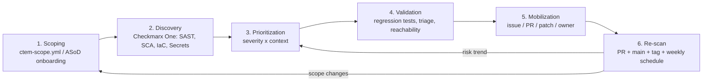

# CTEM Lifecycle with Checkmarx One

Continuous Threat Exposure Management (CTEM) is a continuous program with five stages: **Scoping → Discovery → Prioritization → Validation → Mobilization**. This POC adds an explicit **Re-scan / Continuous Monitoring** step to close the loop.



## Pipeline view

```text
Developer push / PR
   └─ GitHub repository
        ├─ .github/workflows/ci.yml          → tests (security regression tests report XFAIL/PASS)
        └─ .github/workflows/checkmarx.yml   → Checkmarx One scan (SAST, SCA, IaC, optional Secrets)
                ├─ results in Checkmarx One (triage, states, severity)
                ├─ SARIF → GitHub code scanning
                ├─ PR decoration
                └─ artifact: cx_result.*
```

## 1. Scoping

**Goal:** decide what matters and why, before scanning.

| Artifact | Purpose |
|---|---|
| [`ctem-scope.yml`](../ctem-scope.yml) | Illustrative record of owner, exposure, data classification, criticality, in/out-of-scope assets, SLA targets |
| [`docs/asod-integration.md`](asod-integration.md) | Where real scoping data comes from (ASoD onboarding, application inventory) |

**Checkmarx role:** the Checkmarx project (name, tags, groups/application) is the technical anchor for the scoped asset. Mapping repository → application → Checkmarx project is decided here.

**Talking point:** "Not every repository is equal. The same SQL injection is a different risk in an internet-facing payment app than in an internal lab portal."

## 2. Discovery

**Goal:** find exposures across code, dependencies, configuration and secrets.

| Engine (scan type) | What it finds here |
|---|---|
| SAST (`sast`) | CTEM-SAST-01…05 |
| SCA (`sca`) | CTEM-SCA-01 |
| IaC Security (`iac-security`) | CTEM-IAC-01, CTEM-IAC-02 |
| Secret detection (`scs` + `--scs-engines secret-detection`, if licensed) | CTEM-SECRET-01 |

Triggered by [`checkmarx.yml`](../.github/workflows/checkmarx.yml) on PR, push to `main`, tags `v*`, manual dispatch, and a weekly schedule.

**Do not fabricate results.** Show the real Checkmarx One project/scan. Use [`security-scenarios.md`](security-scenarios.md) to explain each finding.

## 3. Prioritization

**Goal:** rank by *risk in context*, not by raw severity count.

See [`prioritization.md`](prioritization.md) for the illustrative model: scanner severity × exposure × data sensitivity × exploitability/reachability × asset criticality.

**Checkmarx role:** severity, CWE, data-flow evidence (source → sink), SCA exploitable-path/reachability information where available, and triage states.

## 4. Validation

**Goal:** confirm the exposure is real and that a fix actually removes it.

| Validation evidence | Where |
|---|---|
| Data-flow path from input to sink | Checkmarx One result details |
| Benign local reproduction (lab only) | [`tests/security/`](../tests/security/) — e.g. UNION probe against local SQLite, `../` probe against local file |
| Reachability (SCA) | Dependency is installed but not imported → discuss lower exploitability |
| False-positive / not-exploitable triage | Checkmarx triage state + justification |

Security regression tests are marked `xfail(strict=True)` while the exposure is open. `pytest -ra` lists every open exposure as `XFAIL`.

## 5. Mobilization / Remediation

**Goal:** get the right fix to the right owner, quickly, with an audit trail.

| Step | How in this POC |
|---|---|
| Create work item | GitHub issue per prioritized finding (or ASoD ticketing integration) |
| Assign owner | From `ctem-scope.yml` / CODEOWNERS / ASoD ownership data |
| Implement fix | `scripts/apply-remediation.sh CTEM-SAST-01` (or write it live) |
| Prove fix | Regression test flips from `XFAIL` to `PASS`; strict marker removed by the patch |
| Review | PR → CI + Checkmarx PR scan/decoration |

See [`remediation-workflow.md`](remediation-workflow.md).

## 6. Re-scan / Continuous monitoring

**Goal:** confirm risk reduction and catch new exposures.

- PR scan shows the finding resolved before merge.
- `main` scan after merge updates the project's risk posture.
- Tag `v0.2-demo-remediated` gives a clean comparison point vs. `v0.1-demo-vulnerable`.
- Weekly scheduled scan detects new CVEs in unchanged dependencies (SCA).
- Strict regression tests prevent the same flaw from silently returning.

**Metrics to show** (from real data only): open findings by severity over time, mean time to remediate, % of prioritized exposures fixed within SLA, findings re-opened.
